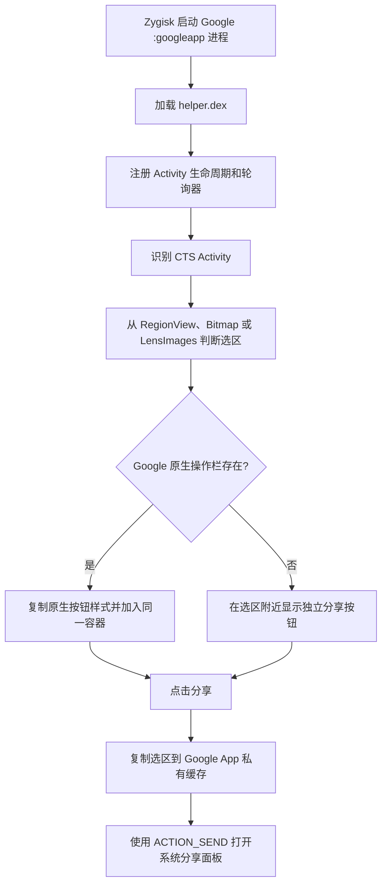

# CTS Selection Share 独立版项目说明

## 用途

本项目是面向 arm64 Android 设备的 Zygisk 模块。它只注入 Google App 的
`com.google.android.googlequicksearchbox:googleapp` 进程，在 Circle to Search
完成选区后加入“分享”按钮，并通过 Android 系统分享面板发送选区图片。

此目录延续 Pixel 使用的 `0.5.6-debug3` 独立版，当前版本为 `0.5.6-debug4`。
与 N6 国行整合模块无依赖关系，不包含 VMTools、国行触发或系统会话协议。

## 架构与文件

- `jni/main.cpp`：Zygisk 入口。仅在目标进程读取 `helper.dex`，通过
  `InMemoryDexClassLoader` 加载 `dev.ctsshare.ShareBootstrap`。
- `java/dev/ctsshare/ShareBootstrap.java`：监听 CTS Activity 生命周期、识别选区、
  注入和定位按钮、准备临时图片、启动系统分享面板，并维护 CTS 返回来源任务。
- `module/`：Magisk/KernelSU 通用模块元数据和安装脚本。
- `build.ps1`：编译 Java/Dex 和 arm64 原生库，组装可安装 ZIP。
- `scripts/module-package.ps1`：将安装文本统一为 UTF-8 无 BOM、LF 换行，检查最终 ZIP。
- `tests/`：打包回归测试，以及使用模拟安装器函数执行安装脚本的 Linux 测试。
- `.github/workflows/build.yml`：独立发布仓库的 Windows 构建与 Linux 安装脚本回归。
- `jni/zygisk.hpp`：项目使用的 Zygisk API 头文件。

## 执行流程



选区矩形优先从 Google `RegionView` 的内部状态读取。由于 Google App 类名和成员会
混淆，代码会同时尝试已知方法、已知字段和类型扫描；缓存的矩形访问器失效时会重新
扫描。活动 `Region` 与有效归一化 `RectF` 同时存在即视为有效选区，不依赖“选择文本”
按钮是否出现。

独立显示的按钮使用原深色圆角底色、白色低透明度 `RippleDrawable` 及同形状遮罩。
Android 原生 View 状态控制按下变亮、松开消退、手指移出取消；不新增触摸拦截、点击延时
或全局动画。与“选择文本”并排的按钮保持原生样式。图片处理、分享及返回行为不变。

## 图片与临时数据

优先分享当前选区 `Bitmap`；无法取得时回退到 Google App 私有目录中的
`files/LensImages`。分享文件写入 Google App 的 `cache/cts-share`，通过其现有
`FileProvider` URI 授权给接收应用。临时文件十分钟后删除，Google App 进程下次启动时
也会清理，不写入相册。

生命周期监听注册后，模块会主动扫描 `ActivityThread.mActivities`，恢复绑定已经处于
Resumed 状态、但因模块初始化较晚而错过 `onActivityCreated/onActivityResumed` 的 CTS
Activity。初始化后的前 30 秒内，在尚未绑定 CTS Activity 时还会每 500 ms 重试一次；
正常情况下仍以 `ActivityLifecycleCallbacks` 为主。

## CTS 返回来源

模块在新 CTS 会话开始时保存当时位于 CTS 后面的任务。系统分享面板返回时仍回到 CTS；
用户从 CTS 本身按返回键时，使用 `ActivityManager.moveTaskToFront` 返回该次 CTS 的来源
任务。切换其他应用再回到同一 CTS 不会覆盖来源；再次触发新的 CTS 会重新保存来源。

## 构建、安装与诊断

运行 `build.ps1 -NdkPath <NDK目录>`。构建依赖 Android SDK 36.1、Build Tools 37.0.0、JBR 21 和
Android NDK r29，输出位于 `build/`。安装 ZIP 后必须重启，使 Zygisk 在 Google App
进程创建时加载模块。

KernelSU/ReSukiSU 需要额外安装并启用兼容的 Zygisk 实现（例如 Zygisk Next）。本模块
不挂载 `system/`，无需为它单独安装或禁用 metamodule。安装脚本只检查 arm64 架构并设置
权限；CTS 注入和分享实现与 Magisk 使用同一份代码。

`.gitattributes` 强制 shell 脚本及模块属性使用 LF。即使来源文件含 Windows 换行，构建时
也会把暂存的 `customize.sh` 和 `module.prop` 规范化为 UTF-8 无 BOM、LF，且不修改 Dex
和原生库。打包后校验 ZIP 必需条目，拒绝带 CR、BOM 或空关键文件的产物。

`tests/test-package.ps1` 检查文本正规化和坏包拒绝。Linux BusyBox ash 可通过
`tests/test-customize.sh` 模拟 arm64 KernelSU/Magisk 安装及非 arm64 拒绝路径；
模拟测试不能替代真机安装和 CTS 按压、取消、分享测试。

独立发布仓库的 CI 在推送后构建并校验最终 ZIP，再由 Linux BusyBox ash 执行包内安装
脚本的模拟测试。CI 不自动发布 Release，也不代表 Android CTS 真机功能已测试。

日志标签为 `CTSShareZygisk`，可使用：

```text
adb logcat -s CTSShareZygisk
```

Debug 构建还会把 CTS 生命周期、选区识别各阶段状态、按钮容器状态和分享结果写入：

```text
/data/data/com.google.android.googlequicksearchbox/files/cts-share-debug.log
/data/data/com.google.android.googlequicksearchbox/files/cts-share-debug.log.1
```

仅在状态改变时写入，并至少间隔 250 ms；每个文件最多约 32 KB，轮转后总量最多约
64 KB。日志不包含截图、选区图片、页面文字或用户标识。

当前只构建 `arm64-v8a`。选区识别依赖 Google App 的内部 View 和混淆成员，Google App
更新后如果结构改变，可能需要重新适配。项目不保存用户截图作为诊断文件。
